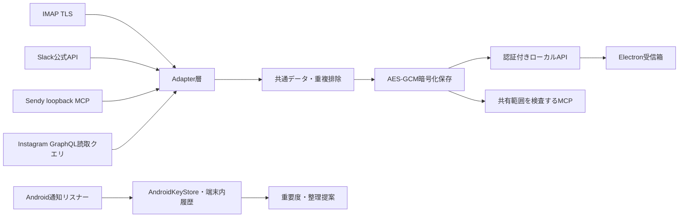

# 技術構成

## 採用構成

TypeScript + Node.js相当のElectronメインプロセス。レンダラーはローカルHTTP上のHTML/CSS/JavaScript。将来のモバイルクライアントもAPI境界を共有する。React等を導入せず初期の依存とビルド負担を減らした。Electron 45.0.0、ImapFlow 2.9.1、mailparser 3.12.4。解決済み依存はpackage-lock.jsonで固定する。

## 層とファイル

| 役割 | 実装 |
| --- | --- |
| 接続 | `src/adapters/`。ImapFlow、Slack HTTPS、Instagram GraphQL読取、Sendyの読み取りツールだけを呼ぶ |
| 共通データ | `src/model.ts`。Account / Thread / Message / Attachment / Draft |
| クライアント | `ui/`。Node権限なし・sandbox有効なElectronレンダラー |
| 通知 | `android/`。Kotlin通知リスナーとスコアリング。Windowsとの通信は未実装 |
| AI | `src/mcp.ts` とstdioブリッジ。全アカウント拒否から開始 |
| セキュリティ | `src/vault.ts`, `src/server.ts`, `src/main.ts` |

## データ整合性

会話キーはaccountId+threadId、メッセージキーはaccountId+threadId+messageIdのJSON配列。区切り文字を含むIDでも衝突しない。同期データはローカルのピン・フォルダ・重要度を上書きしない。同期は同時に一つ。同期中に削除されたアカウントは結果を破棄する。取得と保存に失敗した場合に成功時刻を更新しない。

初期版は全状態をメモリ上に持ち、保存時に一つの暗号化ファイルを一時ファイルからrenameする。小規模な初期利用を対象とする。大きな履歴ではSQLite/FTSとレコード単位暗号化への移行が必要。削除済みメッセージの同期削除、メールUIDVALIDITY変更時の世代整理、完全なバックフィル、再送・送信重複防止はまだ実装していない。

## 既読

UIの会話表示はローカル状態を読むだけでコネクタを呼ばない。IMAPはEXAMINEとBODY.PEEK。Slackはauth.test / conversations.list / conversations.historyのみ。Sendy経由はコード上の既読制御を調査済みだが、取得時に内部の追加通信が発生する可能性があるため非保証。サービス側動作の実アカウント検証は別途必要。`on-send/always` モードの選択UIは未実装。現在は明示的な既読更新も送信も行わない。

## 認証境界

UIは起動ごとの256bitランダムキーをURLフラグメントで受け取り、履歴から削除してメモリだけに置く。サーバーはlocalhost以外にbindせずHostとOriginを検査。UIリクエストは専用ヘッダーを必須にする。MCPキーはUIキーと独立。AI共有はアカウントごとにデフォルト拒否し、本文取得・検索・返信案保存のすべてで検査する。AIに送信承認ツールは公開しない。MCPキーはローカルUIで再発行可能。CSP、HTMLエスケープ、外部ナビゲーションと権限要求の拒否、外部画像不取得を実装。

## モバイル・常時稼働への移行設計（未実装）

認証付きHTTPSゲートウェイをNodeコアの前段に追加し、デバイスごとに失効可能な鍵を発行する。接続コアを自宅PCまたは将来の常時稼働先へ置く。モバイルは暗号化キャッシュに取得時刻を保存し、PC不在時には古い状態を明示する。外部公開前にOAuth、TLS、監査、レート制限、鍵更新、アクセス取り消しを実装・検証する。現行loopback APIをそのままLANやインターネットへbindしない。

iOSは他アプリの通知本文を横断収集する公開APIを前提としない。基本の受信箱・検索・下書き・返信と自アプリの通知は、直接接続バックエンドを共有するネイティブクライアントとして実装する。macOSはElectron共通コードを利用可能と予想するが、署名・OS鍵・起動はMac上の検証が必要。

## Instagramの本人ログイン

ユーザーが最初の対象としてInstagramを指定したため、Sendy経由に加え独立したログインを実装した。`src/instagram-runtime.ts`は公式ログイン画面を専用の非永続セッションで開く。本人が入力し、sessionid/csrftoken/ds_user_idがそろった場合だけアカウントを登録する。パスワードの読み取り・自動入力・二段階認証の代行はしない。Cookieは他の秘密と同様にAES-GCMで保存し、再起動時は専用セッションに復元する。

旧inbox/threadのREST GETは実接続で404となったため、現行の読み取りGraphQLへ変更した。許可するのはPolarisDirectInboxQueryとIGDThreadDetailQueryの2つだけ。認証Cookieの本人IDと接続のviewerIdが一致しなければ取得しない。認証用HTMLは文字列として解析するだけで、JavaScriptを実行しない。429/560は15分間その接続の取得を止める。同じ本人の重複登録は元接続を上書きせず拒否する。接続を削除するとその接続の一時セッションも消す。ログイン画面の自動遷移はInstagram以外と/direct/を拒否し、受信箱Web画面を自動で開かない。API取得で15会話・283メッセージと再起動復元を確認済み。既読を絶対に防ぐ保証はなく、相手側での検証は今後必要。
